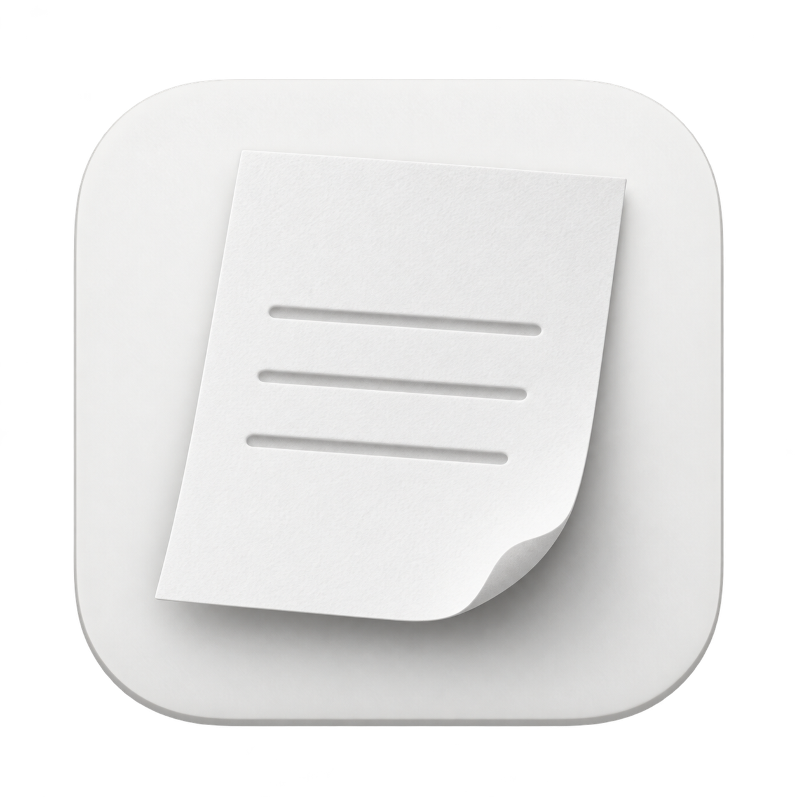
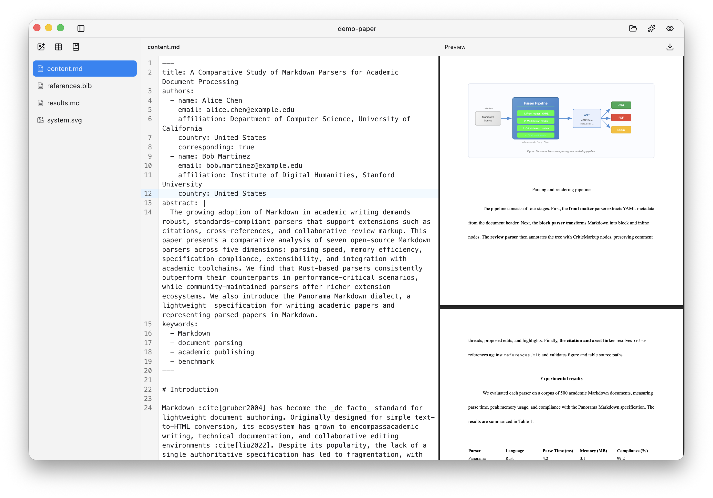
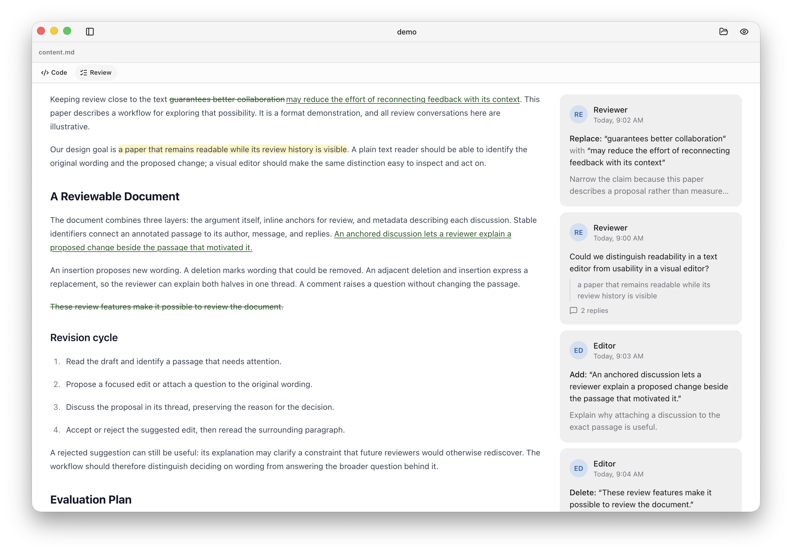

# Panorama Markdown

> [!NOTE]
> Panorama Markdown is preview software, and feedback is very welcome.

Panorama Markdown is a lightweight dialect for writing academic papers and representing parsed PDF papers in Markdown.

It is designed to be friendly to LLMs while staying simple and comfortable for people to write.

## Built on Markdown

- **Standard Markdown** for headings, paragraphs, lists, links, footnotes, and emphasis
- **YAML front matter** for titles, DOIs, authors, abstracts, and keywords
- **Citations** via `:cite` and a `::references` block backed by BibTeX
- **Figures and tables** are imported with directive syntax instead of embedded directly in the Markdown
- **Cross-references** via `:ref` to labeled sections, figures, and tables
- **Comments** anchored to specific passages via `:comment`, with author metadata and threaded replies
- **Suggested edits** via `:insert` and `:delete` for insertions, deletions, and replacements that can be accepted or rejected in the editor

## Specification

The specification is still in progress, but the current format is documented and ready to explore.

Each paper lives in a flat directory of files. The full directory layout and Markdown syntax are defined in **[SPEC.md](SPEC.md)**.

## React renderer

```tsx
import { render } from "@panorama-lab/markdown/react";

render(document, { assets, tableOfContents: true });
```

Enable `tableOfContents` to show a sticky sidebar with links to the document’s headings. The HeroUI “Hide contents” / “Show contents” button toggles it, and heading depth controls indentation. Repeated headings receive unique anchors. Documents without headings omit the sidebar. Existing calls without this option keep their article-only layout. The PDF playground enables the sidebar in its Render tab.

## Typesetting

Markdown defines the content, while layout and styling stay separate. The current tooling can export APA-style PDFs, with support for additional styles planned.

## Editor

Download the latest editor build from the [GitHub releases page](https://github.com/panorama-lab/markdown/releases).

After downloading, open or create a paper directory to start editing and exporting PDFs.

Open the [demo directory](demo) in the editor to explore a [sample paper](demo/content.md) with suggested insertions, deletions, replacements, and threaded comments. Review messages and replies are stored in the paper's front matter alongside the inline review directives.





## Community

- Report bugs, ask questions, or request features on [GitHub Issues](https://github.com/panorama-lab/markdown/issues)
- Join the [Discord server](https://discord.gg/PtgNPuHMFs) to share feedback and discuss the project

## License

Apache 2.0

The optional frontmatter field `doi` stores the paper identifier as a string, for example `doi: "10.1145/3706468.3706491"`. The React renderer displays it below the authors as a link to `doi.org`, opening in a new tab.
